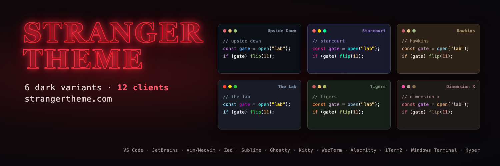
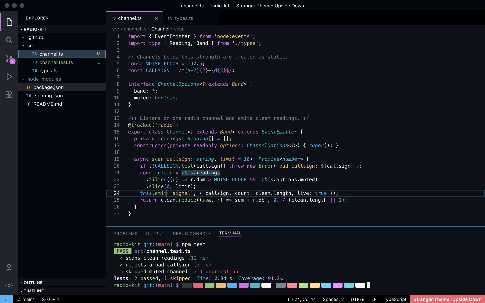
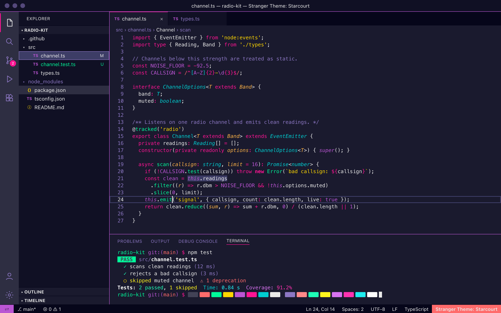
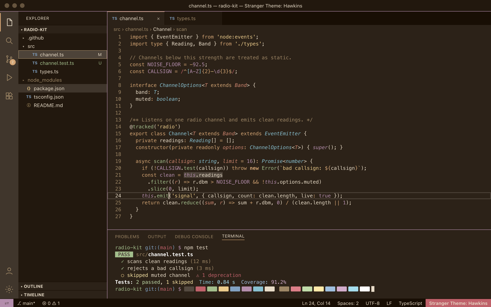
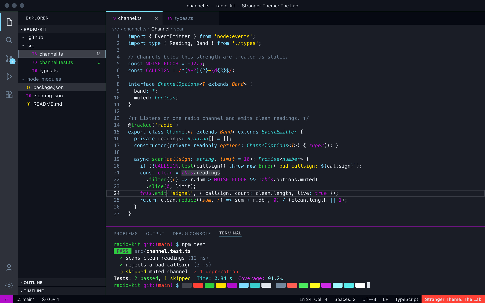
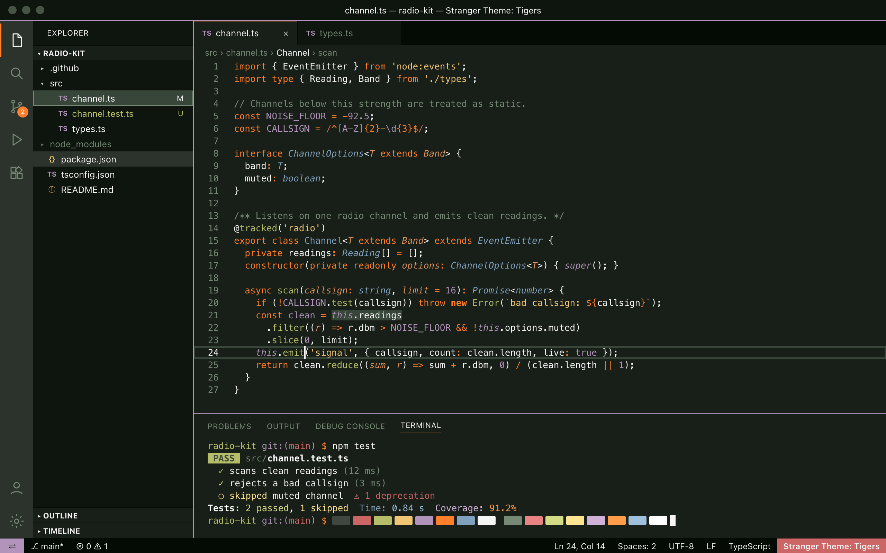
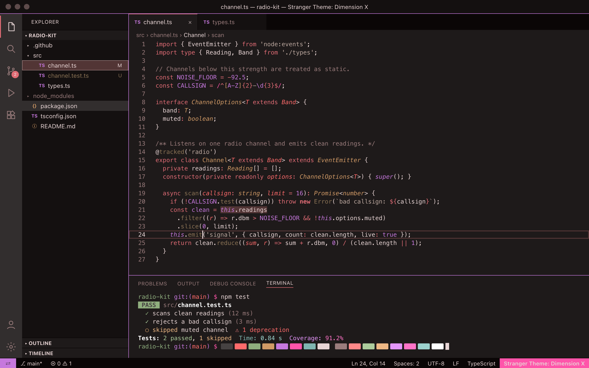

<div align="center">



</div>

# Stranger Theme

> 🔦 A dark theme collection inspired by the famous series Stranger Things

<div align="center">

<a href="https://www.producthunt.com/products/stranger-theme?embed=true&amp;utm_source=badge-featured&amp;utm_medium=badge&amp;utm_campaign=badge-stranger-theme" target="_blank" rel="noopener noreferrer"></a>

</div>

## Theme Variants

Stranger Theme comes in 6 distinct variants, each capturing the essence of different locations and dimensions from the series:

<table>
  <tr>
    <td width="50%" valign="top">
      
      <br /><strong>Upside Down</strong><br />Dark blue-black with desaturated tones
    </td>
    <td width="50%" valign="top">
      
      <br /><strong>Starcourt</strong><br />Vibrant 80s mall aesthetic with neon colors
    </td>
  </tr>
  <tr>
    <td width="50%" valign="top">
      
      <br /><strong>Hawkins</strong><br />Small-town America with warm, muted, autumnal colors
    </td>
    <td width="50%" valign="top">
      
      <br /><strong>The Lab</strong><br />Clinical, institutional aesthetic with sterile colors
    </td>
  </tr>
  <tr>
    <td width="50%" valign="top">
      
      <br /><strong>Tigers</strong><br />School colors with orange/black and vintage academic tones
    </td>
    <td width="50%" valign="top">
      
      <br /><strong>Dimension X</strong><br />Dark red dimension with moody, organic textures
    </td>
  </tr>
</table>

<sub>Previews are rendered from the generated VS Code theme files with <code>npm run screenshots</code>.</sub>

## Install

Choose your platform:

- [Visual Studio Code](./visual-studio-code)
- [JetBrains IDEs](./jetbrains) (IntelliJ IDEA, PyCharm, WebStorm, etc.)
- [Vim/Neovim](./vim)
- [Sublime Text](./sublime-text)
- [Terminal](./terminal) (Alacritty, iTerm2, Windows Terminal, Ghostty, Kitty, WezTerm)
- [Hyper](./hyper)
- [Zed](./zed)

Each platform directory contains installation instructions specific to that environment.

## Color Palette

All 6 theme variants are built from shared color definitions. The example below uses the Upside Down palette (see `shared/palettes.js` for all variants).

| Palette | Hex | RGB | HSL | Swatch |
| --- | --- | --- | --- | --- |
| Background | `#0D1117` | 13 17 23 | 216° 28% 7% |  |
| Current Line | `#21252B` | 33 37 43 | 216° 13% 15% |  |
| Selection | `#2A3C4A` | 42 60 74 | 206° 28% 23% |  |
| Foreground | `#F8F8F2` | 248 248 242 | 60° 30% 96% |  |
| Comment | `#7A8495` | 122 132 149 | 218° 11% 53% |  |
| Cyan | `#56B6C2` | 86 182 194 | 187° 47% 55% |  |
| Green | `#98C379` | 152 195 121 | 95° 38% 62% |  |
| Orange | `#D19A66` | 209 154 102 | 29° 54% 61% |  |
| Pink | `#C678DD` | 198 120 221 | 286° 60% 67% |  |
| Purple | `#61AFEF` | 97 175 239 | 207° 82% 66% |  |
| Red | `#E06C75` | 224 108 117 | 355° 65% 65% |  |
| Yellow | `#E5C07B` | 229 192 123 | 39° 67% 69% |  |

## Development

### Building Themes

All themes are generated from shared color palettes in `shared/palettes.js`:

```bash
# Build all platforms
npm run build

# Build specific platforms
npm run build:vscode
npm run build:jetbrains
npm run build:vim
npm run build:sublime
npm run build:terminal
npm run build:hyper
npm run build:zed

# Validate the four new clients, all six variants, and unchanged legacy output
npm test

# Re-render the README previews after a palette change (macOS + Google Chrome; run `npm install` first)
npm run screenshots
```

### Adding a New Variant

1. Add the new palette to `shared/palettes.js`
2. Run `npm run build` from the root directory
3. All platforms will automatically generate the new variant

For detailed architecture and development guidelines, see [CLAUDE.md](./CLAUDE.md).

## Contributing

Contributions are welcome! See our [Contributing Guide](./CONTRIBUTING.md) for details on:

- Setting up your development environment
- Making changes to themes
- Submitting pull requests
- Adding support for new platforms

## Team

This theme is maintained by [@tcvieira](https://github.com/tcvieira) and [contributors](https://github.com/stranger-theme/stranger-theme/graphs/contributors).

## License

[MIT License](./LICENSE) © Stranger Theme
