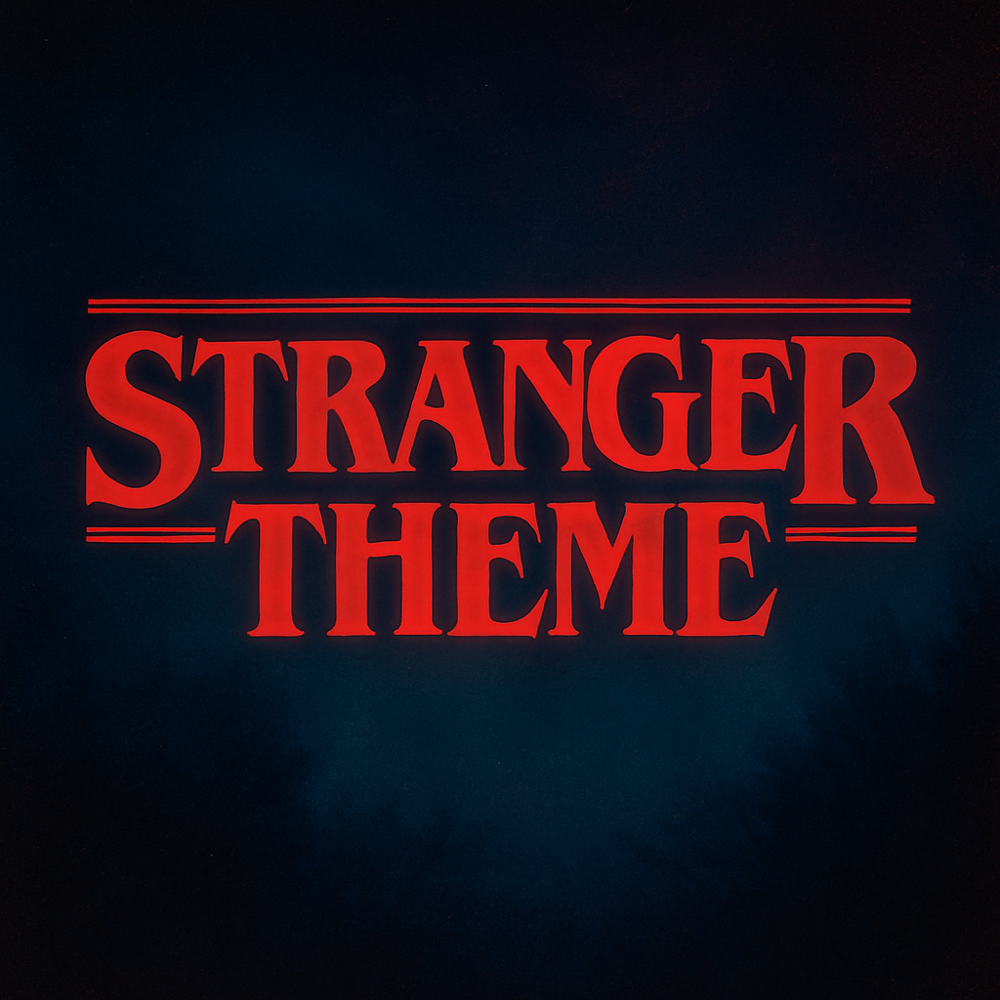

<div align="center">



</div>

# Stranger Theme for Hyper

> 🔦 A dark theme collection for Hyper Terminal inspired by the famous series Stranger Things

## Install

Use the local installation below when the package is unavailable on npm. The CLI and `plugins` methods require a published npm package.

#### Using Hyper CLI

```bash
hyper i hyper-stranger-theme-starcourt
```

#### Manual Installation

1. Edit `~/.hyper.js`
2. Add theme to `plugins` array:

```javascript
module.exports = {
  plugins: [
    'hyper-stranger-theme-starcourt'
  ],
};
```

3. Restart Hyper

#### Local Installation

Run from this `hyper/` directory in a cloned repository. Open Hyper's preferences to find the active configuration file. For Hyper 3, the local plugin directory is:

- macOS: `~/Library/Application Support/Hyper/.hyper_plugins/local/`
- Linux: `~/.config/Hyper/.hyper_plugins/local/`
- Windows: `%APPDATA%\Hyper\.hyper_plugins\local\`

For example, on macOS:

```bash
# Copy theme to local plugins
mkdir -p "$HOME/Library/Application Support/Hyper/.hyper_plugins/local"
cp -r themes/hyper-stranger-theme-starcourt "$HOME/Library/Application Support/Hyper/.hyper_plugins/local/"
```

Merge into `localPlugins` in the active `.hyper.js`, preserving your existing configuration:

```javascript
module.exports = {
  localPlugins: [
    'hyper-stranger-theme-starcourt'
  ],
};
```

## Theme Variants

Each variant is generated as a separate plugin package:

- `hyper-stranger-theme-upside-down` - Dark blue-black with desaturated tones
- `hyper-stranger-theme-starcourt` - Vibrant 80s mall aesthetic with neon colors
- `hyper-stranger-theme-hawkins` - Small-town America with warm, muted colors
- `hyper-stranger-theme-the-lab` - Clinical, institutional aesthetic
- `hyper-stranger-theme-tigers` - School colors with orange/black tones
- `hyper-stranger-theme-dimension-x` - Dark red dimension with moody textures

## Development

### Building from Source

```bash
npm install
npm run build    # Generates Hyper plugin packages from shared palettes
```

Each theme is a standalone npm package with:
- `index.js` - Theme colors and CSS
- `package.json` - npm metadata

## Contributing

Contributions are welcome! See the main repository's [Contributing Guide](../CONTRIBUTING.md).

## Team

This theme is maintained by [@tcvieira](https://github.com/tcvieira) and [contributors](https://github.com/stranger-theme/stranger-theme/graphs/contributors).

## License

[MIT License](../LICENSE) © Stranger Theme
