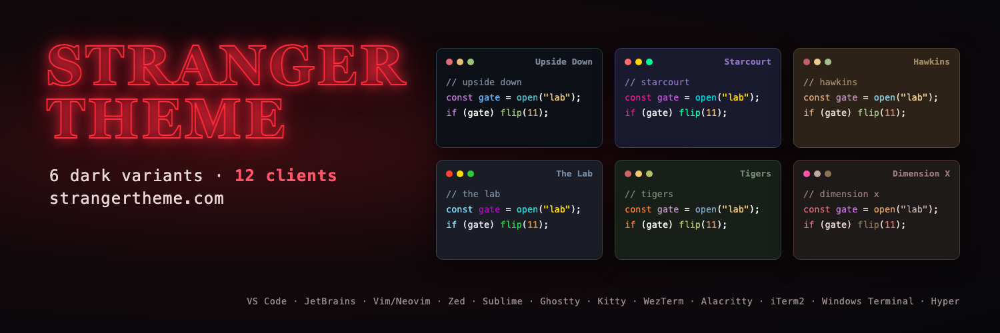

# Stranger Theme: Dimension X for Hyper

Add the theme to the `plugins` list in `~/.hyper.js`:

```js
plugins: ["hyper-stranger-theme-dimension-x"]
```

Or install it with `hyper i hyper-stranger-theme-dimension-x`.

Other variants, editors and terminals: https://github.com/stranger-theme/stranger-theme
