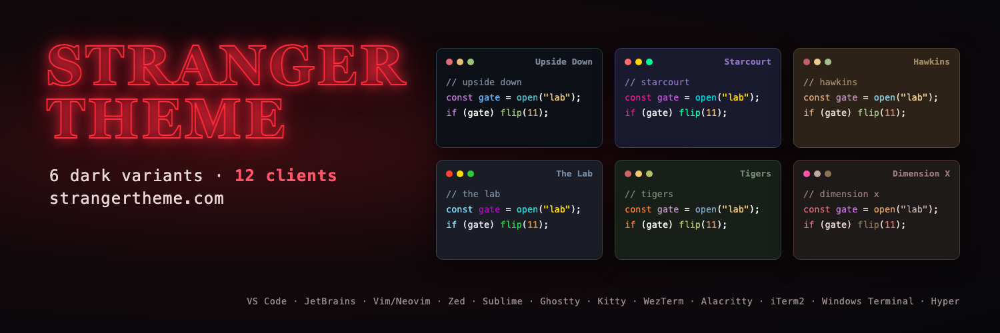

<div align="center">



</div>

# Stranger Theme for Sublime Text

> 🔦 A dark theme collection inspired by the famous series Stranger Things

## Install

#### Using Package Control

1. Open **Command Palette**: `Ctrl+Shift+P` / `Cmd+Shift+P`
2. Select **Package Control: Install Package**
3. Search for `Stranger Theme Color Schemes`
4. Press **Enter** to install

#### Manual Installation

1. Download `.tmTheme` files from the `themes/` folder
2. Open Sublime Text → **Preferences** → **Browse Packages**
3. Create a `Stranger Theme` folder
4. Copy the `.tmTheme` files into this folder

## Activate

1. Go to **Preferences** → **Color Scheme**
2. Select your preferred Stranger Theme variant

Or add to `Preferences.sublime-settings`:

```json
{
  "color_scheme": "Packages/Stranger Theme Color Schemes/Stranger-Theme-Starcourt.tmTheme"
}
```

With a manual installation, use the folder you created: `Packages/Stranger Theme/...`.

## bat and delta

[bat](https://github.com/sharkdp/bat) reads `.tmTheme` files, and [delta](https://github.com/dandavison/delta) uses bat's theme set, so the files in `themes/` work in both.

```bash
mkdir -p "$(bat --config-dir)/themes"
cp themes/Stranger-Theme-*.tmTheme "$(bat --config-dir)/themes/"
bat cache --build
bat --list-themes | grep Stranger
```

Use a theme for one call with `bat --theme=Stranger-Theme-Starcourt file.js`, or make it the default with `export BAT_THEME="Stranger-Theme-Starcourt"` in your shell profile (or `--theme="Stranger-Theme-Starcourt"` in `$(bat --config-file)`).

For delta, set the syntax theme in `~/.gitconfig`:

```ini
[delta]
    syntax-theme = Stranger-Theme-Starcourt
```

Run `bat cache --build` again after updating the `.tmTheme` files.

## Theme Variants

- **Upside Down** - Dark blue-black with desaturated tones
- **Starcourt** - Vibrant 80s mall aesthetic with neon colors
- **Hawkins** - Small-town America with warm, muted colors
- **The Lab** - Clinical, institutional aesthetic
- **Tigers** - School colors with orange/black tones
- **Dimension X** - Dark red dimension with moody textures

## Development

### Building from Source

```bash
npm install
npm run build    # Generates .tmTheme files from shared palettes
```

## Contributing

Contributions are welcome! See the main repository's [Contributing Guide](../CONTRIBUTING.md).

## Team

This theme is maintained by [@tcvieira](https://github.com/tcvieira) and [contributors](https://github.com/stranger-theme/stranger-theme/graphs/contributors).

## License

[MIT License](./LICENSE) © Stranger Theme
