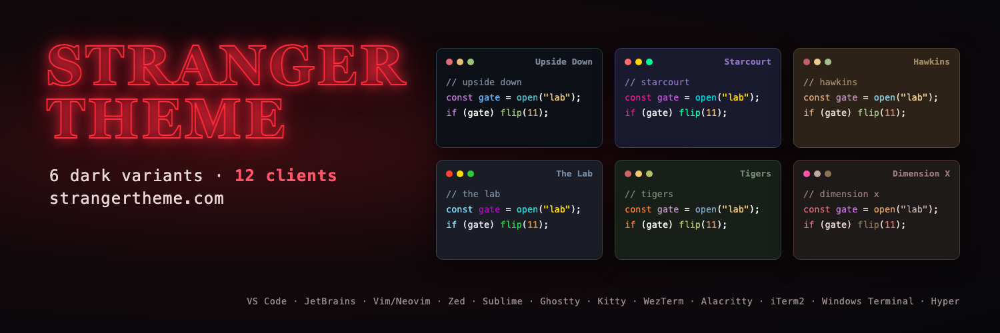

<div align="center">



</div>

# Stranger Theme for Terminal Emulators

> 🔦 A dark theme collection for Alacritty, iTerm2, Windows Terminal, Ghostty, Kitty, WezTerm, Warp and macOS Terminal inspired by the famous series Stranger Things

## Supported Terminals

- [Alacritty](#alacritty)
- [iTerm2](#iterm2)
- [Windows Terminal](#windows-terminal)
- [Ghostty](#ghostty)
- [Kitty](#kitty)
- [WezTerm](#wezterm)
- [Warp](#warp)
- [macOS Terminal](#macos-terminal)

Download the matching archive from [Releases](https://github.com/stranger-theme/stranger-theme/releases), or clone this repository. Run copy commands from the extracted archive directory or this `terminal/` directory. Each client includes all six variants; replace `starcourt` in filenames to choose another variant.

## Theme Variants

- **Upside Down** - Dark blue-black with desaturated tones
- **Starcourt** - Vibrant 80s mall aesthetic with neon colors
- **Hawkins** - Small-town America with warm, muted colors
- **The Lab** - Clinical, institutional aesthetic
- **Tigers** - School colors with orange/black tones
- **Dimension X** - Dark red dimension with moody textures

---

## Alacritty

### Install

```bash
# Create themes directory
mkdir -p ~/.config/alacritty/themes

# Copy theme
cp alacritty/stranger-theme-starcourt.toml ~/.config/alacritty/themes/
```

Import in `alacritty.toml`:

```toml
import = ["~/.config/alacritty/themes/stranger-theme-starcourt.toml"]
```

---

## iTerm2

### Install

1. Open **iTerm2** → **Preferences** → **Profiles** → **Colors**
2. Click **Color Presets** → **Import**
3. Select the `.itermcolors` file from `iterm2/` folder
4. Select the imported theme from **Color Presets**

---

## Windows Terminal

### Install all six schemes (fragment)

Copy the fragment file, which holds all six schemes, into the Windows Terminal fragments folder (PowerShell):

```powershell
$dir = "$env:LOCALAPPDATA\Microsoft\Windows Terminal\Fragments\StrangerTheme"
New-Item -ItemType Directory -Force $dir | Out-Null
Copy-Item windows-terminal\fragment\stranger-theme.json $dir
```

Restart Windows Terminal, then pick a **Stranger Theme** scheme under **Settings** → your profile → **Appearance** → **Color scheme**. See [JSON fragment extensions](https://learn.microsoft.com/windows/terminal/json-fragment-extensions).

### Install one scheme by hand

1. Open **Settings** (`Ctrl+,`) → **Open JSON file**
2. Add theme to `schemes` array (paste contents from `windows-terminal/` JSON file)
3. Set your profile:

```json
{
  "profiles": {
    "defaults": {
      "colorScheme": "Stranger Theme: Starcourt"
    }
  }
}
```

---

## Ghostty

Copy the theme into Ghostty's user theme directory (macOS or Linux):

```bash
mkdir -p "${XDG_CONFIG_HOME:-$HOME/.config}/ghostty/themes"
cp ghostty/stranger-theme-starcourt "${XDG_CONFIG_HOME:-$HOME/.config}/ghostty/themes/"
```

Add this line to the configuration file opened by Ghostty's **Open Configuration** action:

```ini
theme = stranger-theme-starcourt
```

Reload the configuration or restart Ghostty. Explicit color settings in your own configuration override the theme. See [Ghostty custom themes](https://ghostty.org/docs/features/theme#authoring-a-custom-theme).

---

## Kitty

Copy the theme into Kitty's configuration directory (macOS or Linux):

```bash
mkdir -p "${XDG_CONFIG_HOME:-$HOME/.config}/kitty/themes"
cp kitty/stranger-theme-starcourt.conf "${XDG_CONFIG_HOME:-$HOME/.config}/kitty/themes/"
```

Add this line to `kitty.conf` in that configuration directory, after any existing color settings:

```conf
include themes/stranger-theme-starcourt.conf
```

Reload `kitty.conf` or restart Kitty. See [Kitty configuration](https://sw.kovidgoyal.net/kitty/conf/).

---

## WezTerm

Copy the theme to WezTerm's color scheme directory (macOS or Linux):

```bash
mkdir -p ~/.config/wezterm/colors
cp wezterm/stranger-theme-starcourt.toml ~/.config/wezterm/colors/
```

In your existing `~/.wezterm.lua` or `~/.config/wezterm/wezterm.lua`, set this before `return config`:

```lua
config.color_scheme = 'Stranger Theme: Starcourt'
```

For a new configuration file, use:

```lua
return {
  color_scheme = 'Stranger Theme: Starcourt',
}
```

On Windows, copy the TOML into a `colors` directory beside `wezterm.exe`, or place it in another directory and add that path to `config.color_scheme_dirs`. Restart WezTerm if the scheme does not appear. Existing `config.colors` values can override the scheme. See [WezTerm color scheme files](https://wezterm.org/config/appearance.html#defining-a-color-scheme-in-a-separate-file).

---

## Warp

Copy the themes into Warp's custom theme directory:

```bash
# macOS
mkdir -p ~/.warp/themes
cp warp/stranger_theme_*.yaml ~/.warp/themes/

# Linux
mkdir -p "${XDG_DATA_HOME:-$HOME/.local/share}/warp-terminal/themes"
cp warp/stranger_theme_*.yaml "${XDG_DATA_HOME:-$HOME/.local/share}/warp-terminal/themes/"
```

On Windows, copy them to `%APPDATA%\warp\Warp\data\themes\`. Then open **Settings** → **Appearance** → **Themes** and choose **Stranger Theme: Starcourt** (or another variant). See [Warp custom themes](https://docs.warp.dev/features/themes/custom-themes).

---

## macOS Terminal

1. Double-click `terminal-app/Stranger-Theme-Starcourt.terminal`, or open **Terminal** → **Settings** → **Profiles**, click the **⋯** menu below the profile list and choose **Import…**
2. Select the new **Stranger Theme: Starcourt** profile and click **Default** to use it for new windows.

The profile sets only colours; choose your font in the profile's **Text** tab.

---

## Development

### Building from Source

```bash
npm run build    # Generates themes for all terminals from shared palettes
```

## Contributing

Contributions are welcome! See the main repository's [Contributing Guide](../CONTRIBUTING.md).

## Team

This theme is maintained by [@tcvieira](https://github.com/tcvieira) and [contributors](https://github.com/stranger-theme/stranger-theme/graphs/contributors).

## License

[MIT License](../LICENSE) © Stranger Theme
