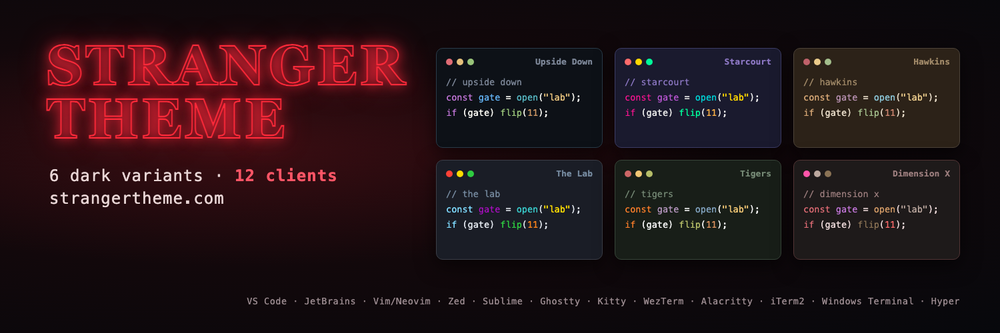

<div align="center">



</div>

# Stranger Theme for Vim/Neovim

> 🔦 A dark colorscheme collection inspired by the famous series Stranger Things

## Install

The repository root ships `colors/` and `lua/`, so plugin managers need no `rtp` setting.

#### Using lazy.nvim (Neovim)

```lua
{
  'stranger-theme/stranger-theme',
  lazy = false,
  priority = 1000,
  config = function()
    require('stranger-theme').setup({ variant = 'starcourt' })
  end,
}
```

#### Using packer.nvim (Neovim)

```lua
use {
  'stranger-theme/stranger-theme',
  config = function()
    require('stranger-theme').setup({ variant = 'starcourt' })
  end,
}
```

#### Using vim-plug

```vim
Plug 'stranger-theme/stranger-theme'
" after plug#end():
colorscheme stranger_starcourt
```

#### Manual Installation

```bash
# Vim
mkdir -p ~/.vim/colors
cp colors/*.vim ~/.vim/colors/

# Neovim
mkdir -p ~/.config/nvim/colors
cp colors/*.vim ~/.config/nvim/colors/
```

## Activate

Add to your `.vimrc` or `init.vim`:

```vim
set termguicolors
colorscheme stranger_starcourt
```

Or in Neovim `init.lua`:

```lua
vim.opt.termguicolors = true
vim.cmd('colorscheme stranger_starcourt')
```

Switch variant at any time with `require('stranger-theme').load('hawkins')` or `:colorscheme stranger_hawkins`.

## Options

Set these before `colorscheme`, or pass them to `setup()` in Neovim:

| `setup()` option | Vim variable | Default | Effect |
| --- | --- | --- | --- |
| `transparent = true` | `let g:stranger_transparent_background = 1` | off | No background on `Normal`, `NormalNC`, `SignColumn`, `FoldColumn` and `EndOfBuffer` |
| `italic = false` | `let g:stranger_disable_italic = 1` | italic on | Removes italics from comments, attributes and other groups |
| `dim_inactive = true` | `let g:stranger_dim_inactive = 1` | off | Darker background (`NormalNC`) for inactive windows |

```lua
require('stranger-theme').setup({
  variant = 'hawkins',   -- upside_down, starcourt, hawkins, the_lab, tigers, dimension_x
  transparent = false,
  italic = true,
  dim_inactive = false,
})
```

### lualine

```lua
require('lualine').setup({ options = { theme = 'stranger_starcourt' } })
```

## Theme Variants

- `stranger_upside_down` - Dark blue-black with desaturated tones
- `stranger_starcourt` - Vibrant 80s mall aesthetic with neon colors
- `stranger_hawkins` - Small-town America with warm, muted colors
- `stranger_the_lab` - Clinical, institutional aesthetic
- `stranger_tigers` - School colors with orange/black tones
- `stranger_dimension_x` - Dark red dimension with moody textures

## Plugin Support

Includes highlight groups for:

- Treesitter and LSP semantic tokens (Neovim)
- LSP diagnostics and floating windows (Neovim)
- Telescope (Neovim)
- nvim-cmp and blink.cmp, including per-kind colours (Neovim)
- gitsigns.nvim (Neovim)
- nvim-tree and neo-tree (Neovim)
- indent-blankline v2 and v3 (Neovim)
- which-key, Trouble, lazy.nvim UI and nvim-dap (Neovim)
- lualine (theme files in `lua/lualine/themes/`)
- NERDTree
- GitGutter

## Development

### Building from Source

```bash
npm install
npm run build    # Generates colorschemes from shared palettes
```

## Contributing

Contributions are welcome! See the main repository's [Contributing Guide](../CONTRIBUTING.md).

## Team

This theme is maintained by [@tcvieira](https://github.com/tcvieira) and [contributors](https://github.com/stranger-theme/stranger-theme/graphs/contributors).

## License

[MIT License](./LICENSE) © Stranger Theme
